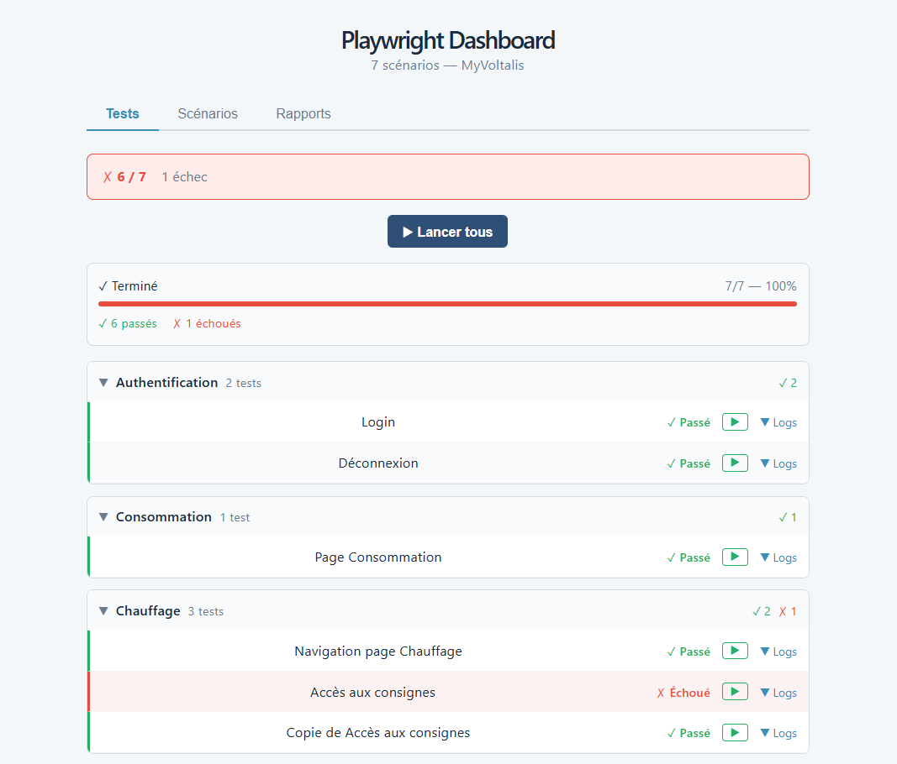
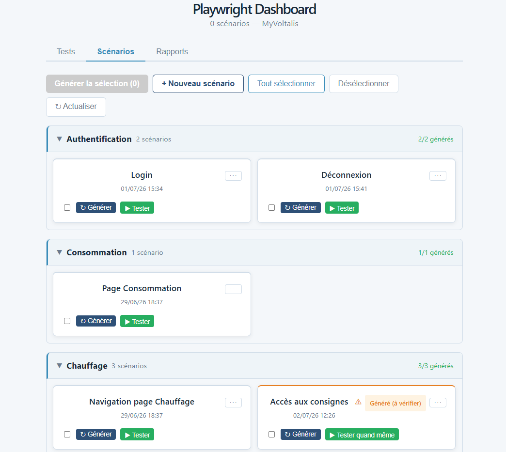

# Playwright LLM Test Generator

Generates end-to-end Playwright tests from plain-language scenarios, and wraps the whole loop (write, generate, run, diagnose, fix) in a small web dashboard.

This repository documents the scope and the technical approach. The source code is not published.

## The problem

Writing and maintaining functional tests for a web application is slow, and the people who know best what should be tested (product, support, QA) are usually not the ones who write Playwright code. Asking an LLM to write tests from a description often fails for a simple reason: it guesses selectors that do not exist on the real page.

## Approach

1. **Scenarios in natural language.** A scenario has a title, a category, an optional list of pages involved, and a list of steps ("click on the Heating tab", "check that a list of devices is visible").
2. **Real DOM extraction before generation.** Playwright opens the application, logs in with test credentials read from environment variables, navigates to the pages involved and extracts the interactive elements actually present (buttons, inputs, links, tabs, switches, dialogs). Extraction runs in several passes to catch elements that appear after an intermediate action.
3. **Grounded generation.** The scenario and the real element list are sent to an LLM (OpenAI API, `gpt-4o-mini`), which writes the Playwright test using selectors that exist on the page.
4. **Ambiguity detection.** Page aliases are mapped to one canonical page, and scenarios that mix ambiguous or unknown pages are flagged with a persistent warning instead of generating a wrong test.
5. **Execution and reports.** Generated tests run through pytest with Playwright, with a status per scenario and downloadable reports.
6. **Failure diagnosis.** Common Playwright failures (timeouts on click, strict mode violations, hidden elements, wrong counts, connection errors) are translated into plain-language explanations that point at the faulty step.
7. **Suggested fix.** When a step is ambiguous, the LLM proposes a shorter, more precise rewording of that step only, with a placeholder for the element to target, so the author stays in control of the scenario.

## Dashboard

A React dashboard lets a non-developer:

- create, edit and delete scenarios, and see the generated test code;
- generate one test or all of them, and follow progress;
- run one test or the whole suite, and see pass/fail per scenario;
- read the diagnosis of a failure and apply the suggested rewording.

## Stack

- **Python**: generation pipeline, test runner
- **Playwright** (sync API) and **pytest**
- **FastAPI**: backend for the dashboard (scenarios, jobs, reports)
- **React + Vite**: dashboard
- **OpenAI API**: test generation and step rewording

## Design choices worth noting

- The LLM never sees a guess of the page, only what is really there. This is what makes generated tests usable without manual selector fixing.
- Credentials never live in the repository: they are read from environment variables.
- Failures are explained to scenario authors, not to developers, because the goal is to let non-developers own the scenarios.

## Limits

- The extraction logic assumes a conventional, accessible DOM; heavily canvas-based screens need manual steps.
- Tests depend on the state of the test account; verifications that are too specific to one account state are flagged in the diagnosis as fragile.

## Author

Built autonomously as a personal product-and-engineering project to explore LLM-assisted QA.
